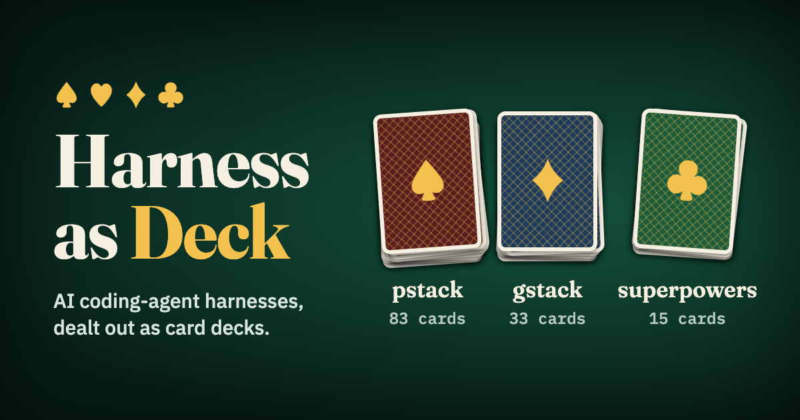

# Harness as Deck

**Live: https://harness-as-card-deck.vercel.app**

Interactive card decks of AI coding-agent harnesses. Each harness is a stack of cards. Shuffle and deal it, then follow the links from skill to skill. Switch decks in the topbar.

| Deck | Source | Cards |
| --- | --- | --- |
| pstack | [cursor/plugins `pstack/`](https://github.com/cursor/plugins/tree/main/pstack) | Skills, playbooks, principles, agents, and the `poteto-mode` router |
| gstack | [garrytan/gstack](https://github.com/garrytan/gstack) | One skill card per top-level skill |
| superpowers | [obra/superpowers](https://github.com/obra/superpowers) | One skill card per skill under `skills/` |
| anthropic | [anthropics/skills](https://github.com/anthropics/skills) | One skill card per Apache-2.0 skill under `skills/`. `docx`, `pdf`, `pptx`, and `xlsx` are source-available and not included |

Each deck uses the commit pinned in `vendor/<id>.sha`.

There are two lenses, Layer and Route Tree. Click a card to pull its neighbours out. Chips in the SKILL.md panel link to the cards they mention, and those cards link back. Before the first deal, the panel shows a short introduction to the harness.

## Develop

- `npm run dev`: builds `src/data/decks.json` from `vendor/`, then starts Vite
- `npm run check`: typecheck and relationship checks
- `npm run build`: static build into `dist/`
- `npm run fetch`: re-download the pinned snapshots
- `data/overrides.json`: manual layer and `{ from, to }` edge corrections applied after regex extraction

## License

The code in this repository is MIT-licensed, see [LICENSE](LICENSE). The harness content it renders is MIT-licensed by its authors (see `public/pstack-LICENSE.txt`, `public/gstack-LICENSE.txt`, and `public/superpowers-LICENSE.txt`), except the anthropic deck, which is Apache-2.0 (see `public/anthropic-LICENSE.txt`).
